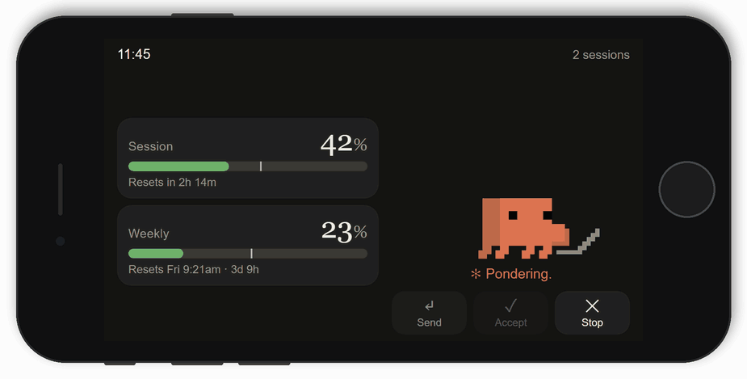

# iphone-clawdmeter

A [Clawdmeter](https://github.com/HermannBjorgvin/Clawdmeter)-style Claude Code usage display on an old iPhone (7, iOS 14.4.2), driven over the USB cable only. No Wi-Fi or Bluetooth.

<p align="center">
  
</p>


## How it works

- `clawdmeter_phone/__main__.py`: the daemon. Every second it reads hook events, every 3 minutes it polls usage, and it pushes state to the phone.
- `clawdmeter_phone/phone.py`: the USB link. Uses Safari's remote Web Inspector (through `pymobiledevice3`) to load `web/page.html` into the visible Safari tab and call `window.__cm.update(...)`. Commands over ~16 KB hang, so the page is sent in 8 KB chunks.
- `clawdmeter_phone/usage.py`: reads Claude Code's OAuth token from `~/.claude/.credentials.json` (read only) and calls the undocumented `api.anthropic.com/api/oauth/usage` endpoint, the same one Clawdmeter uses.
- `clawdmeter_phone/hook.py`: the Claude Code hook. Appends one line per event (event name, session id, short alert text) to `data/events.log` in this folder. Never stores prompts or tool inputs. (Not AppData: Windows redirects AppData writes from the Store-installed Claude app, and everything it launches, to a private copy that terminal sessions can't see.)

## On the phone

- Session and weekly meters with reset countdowns and a pace marker; Clawd reacts to prompts, finishes and alerts.
- A session count: threads with a hook event in the last 5 minutes (Clawdmeter's window), plus any still mid-turn. Sessions are only named on alerts ("from <project folder>").
- Alerts (amber, with chime) for permission prompts, AskUserQuestion, Claude Code notifications, and the desktop app's end-of-turn question box (caught from the PostToolUse hook on `mcp__ccd_turn__wrap_up`).
- A keypad that only offers what can work: a waiting question's own answers (typed into the focused window, then Enter), Stop (Esc) while something is running, Accept (Enter) for permission prompts, and a dimmed Send (Enter).
- Keys go to whichever PC window has focus. The app's Ctrl+Enter shortcut ignored synthesized keys, so answers are typed instead.

## Setup

Phone: Settings > Safari > Advanced, turn on Web Inspector and Remote Automation. Auto-lock to Never, open a Safari tab, optionally pin it with Guided Access. Make sure the silent switch is off, and tap the screen once to enable sound.

PC: iTunes (Microsoft Store version) must be installed, but doesn't need to be open. It carries Apple's USB service, and the daemon starts that service on its own when it isn't running (`clawdmeter_phone/apple_service.py`). To have it running from login, turn on iTunes' "Apple Mobile Device" entry in Settings > Apps > Startup.

```bash
uv sync
uv run python -m clawdmeter_phone           # run the daemon
uv run python -m clawdmeter_phone.hooks_setup show       # preview hook changes
uv run python -m clawdmeter_phone.hooks_setup install    # backs up ~/.claude/settings.json first
uv run python -m clawdmeter_phone.hooks_setup uninstall  # remove only this project's hooks
```

`uv run python -m tools.demo` cycles demo states on the phone (idle, working, alert, done). Stop the daemon first; the demo refuses to run while it's up, since both would drive the same page.

The mascot art in `web/clawd.json` is checked in. To regenerate it, `git clone --depth 1 https://github.com/HermannBjorgvin/Clawdmeter vendor/Clawdmeter`, then `uv run python tools/convert_art.py`.

## Undo everything

1. `uv run python -m clawdmeter_phone.hooks_setup uninstall` (removes only this project's hooks; or restore a `settings.json.bak-iphone-clawdmeter-*` backup)
2. Stop the daemon and delete this folder (logs live in `data/`, the dependencies in `.venv/`).
3. On the phone, switch Web Inspector, Remote Automation, auto-lock and Guided Access back
